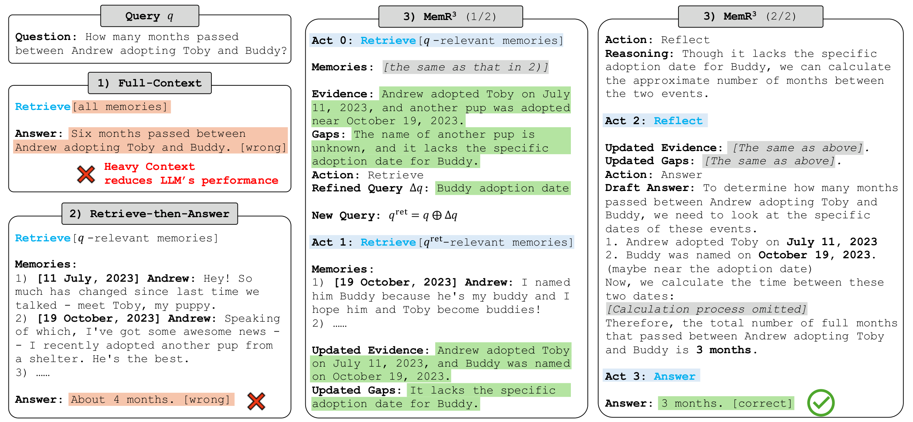
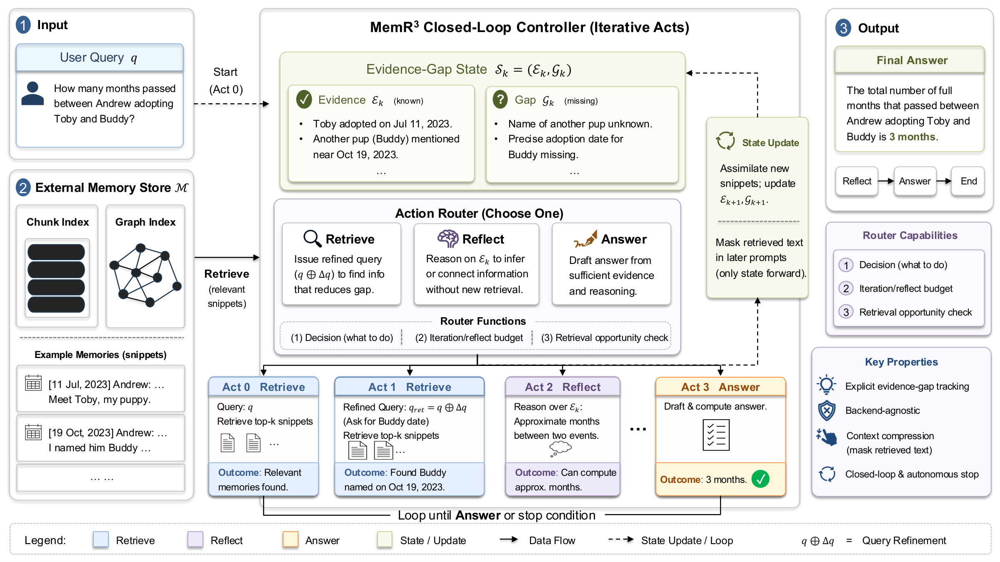

# MemR<sup>3</sup>: Knowing What is Missing: Efficient Conversational Memory via Explicit Evidence-Gap Tracking

[](https://neurips.cc/Conferences/2026)
[](./LICENSE)

Official implementation of **"Knowing What is Missing: Efficient Conversational Memory via Explicit Evidence-Gap Tracking"** (NeurIPS 2026).

**Xingbo Du<sup>1</sup>, Loka Li<sup>1</sup>, Duzhen Zhang<sup>1</sup>, Leonard Song<sup>2</sup>, Le Song<sup>1</sup>**
<sup>1</sup>Mohamed bin Zayed University of Artificial Intelligence, <sup>2</sup>The Westminster Schools

📄 Paper: arXiv link coming soon

**MemR<sup>3</sup>** is a backend-agnostic, closed-loop memory controller for answering questions over long conversations. It keeps an explicit evidence-gap state (what is known and what is still missing) and uses it to route among `retrieve`, `reflect`, and `answer`. Newly retrieved snippets are absorbed into the state and then masked from later prompts, so query-time context scales with the compact state instead of the raw retrieval trajectory. This repo supports two memory backends:
- RAG over chunked chat histories with embedding search and optional cross-encoder reranking.
- Zep graph search over ingested conversation memories.



*Figure 1*: Illustration of three memory-usage paradigms. In this example, **Full-Context** exposes the LLM to many distractors, while **Retrieve-then-Answer** retrieves relevant snippets but still miscalculates. In contrast, **MemR<sup>3</sup>** iteratively retrieves and reflects using an explicit evidence-gap tracker (Acts 0-3). By absorbing information and discarding raw texts, it refines the query and produces the correct answer (3 months) without unbounded context expansion.



*Figure 2*: Pipeline of **MemR<sup>3</sup>**. MemR<sup>3</sup> transforms retrieval into a closed-loop process: a router dynamically switches between Retrieve, Reflect, and Answer nodes while a global evidence-gap tracker maintains what is known and what is still missing. This enables iterative query refinement, targeted retrieval, and early stopping, making MemR<sup>3</sup> an autonomous, backend-agnostic controller.

## Prerequisites
- Install dependencies: `pip install -r requirements.txt`.
- Required environment variables: `OPENAI_API_KEY`, `MODEL` (optional `OPENAI_BASE_URL`).
- RAG mode requires `EMBEDDING_MODEL` (optional `EMBEDDING_API_KEY`, `EMBEDDING_BASE_URL`, `MEMR3_RERANK_MODEL`, `MEMR3_RAG_CACHE_DIR`).
- Zep mode requires `ZEP_API_KEY`.
- Optional `MEMR3_LLM_EXTRA_BODY`: a JSON object forwarded as `extra_body` to every chat-completion call, for provider-specific request fields when `OPENAI_BASE_URL` points to an OpenAI-compatible router such as OpenRouter, e.g. `export MEMR3_LLM_EXTRA_BODY='{"provider": {"sort": "throughput"}}'`.
- Optional `MEMR3_RAG_EMBED_RETRIES` (default `5`) and `MEMR3_RAG_EMBED_RETRY_DELAY_SECONDS` (default `20`) control retries of failed embedding requests in RAG mode.

## Datasets
We evaluate on the LoCoMo 10 conversation set using the Google Drive repository of the mem0 team: [LOCOMO Dataset](https://drive.google.com/drive/folders/1L-cTjTm0ohMsitsHg4dijSPJtqNflwX-?usp=drive_link).
- `dataset/locomo10.json` is the base dataset for MemR<sup>3</sup>.
- `dataset/locomo10_rag.json` is the chunking-friendly variant used by the RAG backend.

We also evaluate on the [LongMemEval dataset](https://github.com/xiaowu0162/LongMemEval).
- `dataset/longmemeval_s_cleaned.json`.

## Usage
Fill in the API keys at the top of each script, then run:

```
bash example_rag_locomo.sh          # RAG backend on LoCoMo
```

```
bash example_zep_locomo.sh          # Zep backend on LoCoMo
```

```
bash example_rag_longmemeval.sh     # RAG backend on LongMemEval-S
```

Each script runs `run_experiments.py`, then `evals.py` (BLEU / F1 / LLM-judge) and `generate_scores.py` (per-category and overall scores). Outputs are saved under `results/`.

Besides the answer and the evidence-gap trace, every result entry records cost statistics:
- `retrieved_tokens`: tokens of retrieved snippets, counted once per retrieval (reflect steps add none).
- `input_tokens` / `completion_tokens`: total prompt and completion tokens over all LLM calls for the question.
- `search_time` / `response_time`: total retrieval time and total LLM response time (seconds) over all iterations.

## Directory

```
|-- README.md
|-- evals.py
|-- example_rag_locomo.sh
|-- example_zep_locomo.sh
|-- example_rag_longmemeval.sh
|-- generate_scores.py
|-- prompts.py
|-- run_experiments.py
|-- dataset
    |-- locomo10.json
    |-- locomo10_rag.json
    |-- longmemeval_s_cleaned.json
|-- images
    |-- pipeline.png
    |-- motivation.png
|-- metrics
    |-- llm_judge.py
    |-- utils.py
|-- rag_cache
|-- rag_longmemeval_cache
|-- results
|-- src
    |-- memr3_base.py
    |-- memr3_rag.py
    |-- memr3_zep.py
    |-- utils.py
    |-- zep
        |-- zep_ingestion.py
```

## Citation
If you find this work useful, please cite:

```bibtex
@inproceedings{du2026knowing,
  title     = {Knowing What is Missing: Efficient Conversational Memory via Explicit Evidence-Gap Tracking},
  author    = {Du, Xingbo and Li, Loka and Zhang, Duzhen and Song, Leonard and Song, Le},
  booktitle = {Advances in Neural Information Processing Systems},
  year      = {2026}
}
```
